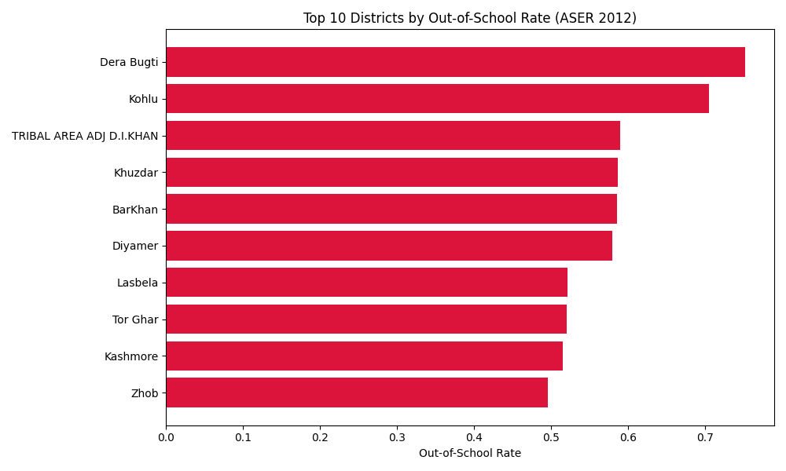
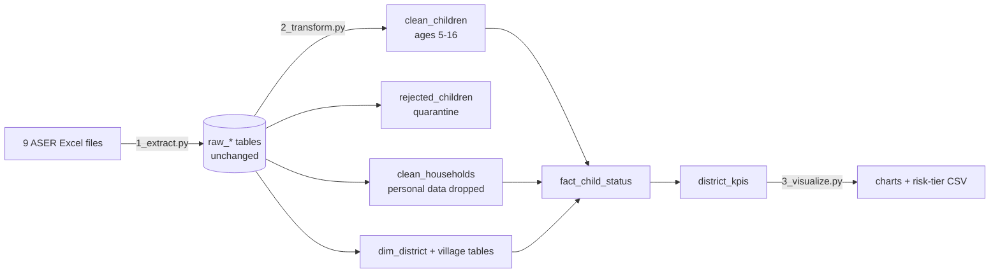

# ASER 2012 ETL Pipeline: Out-of-School Children by District

A working ETL pipeline that loads nine linked tables of Pakistan's ASER 2012 household survey into PostgreSQL, cleans and validates them, and produces district-level out-of-school-children (OOSC) rates and risk tiers.

**Status:** working prototype and learning project. The analysis is descriptive. There is no predictive model yet (see [Limitations](#limitations) and [Next steps](#next-steps)).

## What it found

All numbers below are printed by `3_visualize.py` (children aged 5-16, ASER 2012).

| Finding | Value |
|---|---|
| Children analysed | 216,125 |
| Out of school | 51,835 (24.0%) |
| ...of whom never enrolled | 42,823 (83%) |
| ...of whom dropped out | 9,012 (17%) |
| Out-of-school rate, girls vs boys | 33.2% vs 17.8% |
| Highest-rate district | Dera Bugti, 75.2% (1,269 children sampled) |
| Districts with data | 142 |

The largest single age group among out-of-school children is age 5 (8,792 children), which fits the 83% never-enrolled figure: most of these children never started.



More charts are in [`docs/charts/`](docs/charts/): gender, age, and district risk tiers.

## How it works



| Layer | Tables | Grain |
|---|---|---|
| Raw | `raw_0tblprovince` ... `raw_8gov_school` (9 tables) | as loaded |
| Clean | `clean_children`, `rejected_children`, `clean_households` | child / household |
| Model | `dim_district`, `fact_child_status` | district / child |
| Serve | `district_kpis` | district |

The child-to-district link is: child -> household -> village survey -> village -> district.

## Quality gates

`2_transform.py` runs in one transaction. If any gate fails, it rolls back and writes nothing.

1. `clean + rejected = raw`: no record is silently dropped (216,125 + 37,779 = 253,904)
2. No child is lost in the five-table join (216,125 in, 216,125 out)
3. Every child aged 5-16 has exactly one of the three enrollment flags (never enrolled / dropped out / enrolled)
4. District totals add up to the fact table

Full output of a real run: [`docs/sample_run_output.txt`](docs/sample_run_output.txt).

## Design decisions

- **Transformations are SQL, run inside PostgreSQL.** Pandas is used only to read the results and analyse them.
- **Bad records are quarantined, not deleted.** Children outside ages 5-16, or with no age, go to `rejected_children`.
- **Personal data stops at the raw layer.** Household-head and surveyor names are not carried into `clean_households`.
- **Credentials live in environment variables**, never in code.
- **Safe to re-run:** every derived table is dropped and rebuilt.

## Data notes

- Enrollment status is stored as three separate flag columns (never enrolled, dropped out, enrolled) rather than one categorical column. Gate 3 verifies that exactly one is set for every child in scope.
- Facility fields (electricity, toilet, mobile, TV, computer use) use Microsoft Access-style booleans: `-1` = yes, `0` = no, blank = not asked. They are loaded but not analysed yet.

## Run it

Requirements: Python 3.10+ and PostgreSQL. Tested with PostgreSQL 16 and Python 3.12.

```bash
pip install -r requirements.txt

createdb aser_2012                 # or create it in pgAdmin
cp .env.example .env               # then put your PostgreSQL user/password in .env
# put the 9 ASER files in data/raw/  (see data/README.md)

python 1_extract.py                # raw tables
python 2_transform.py              # clean, model, quality gates
python 3_visualize.py              # findings + charts in outputs/
```

## Limitations

- **One survey year (2012).** No trends, and the findings are historical, not a current picture.
- **Descriptive only.** The patterns show where and for whom the rates are highest, not why.
- **Sample, not census.** District rates rest on roughly 1,200-2,500 sampled children each (for the top ten), and sampling error is not quantified.
- **Risk tiers are relative.** They are percentile cut-offs of the 142 districts, so a "low risk" district can still have a high absolute rate.
- **Not used yet:** parent education, school facilities, school funding and teacher data. They are loaded in the raw layer.

## Next steps

- Join parent-education and school-facility tables to test which factors go with out-of-school status
- Add further survey years and make the pipeline year-aware
- Add a predictive model, only if it beats a simple baseline
- Add automated tests

## Project structure

```
db.py             shared settings, reads credentials from the environment
1_extract.py      Excel -> PostgreSQL raw layer
2_transform.py    SQL layers + quality gates
3_visualize.py    findings, risk tiers, charts
docs/             sample charts and a full sample run
data/             put raw files here (not committed)
```

## Credit

Data: ASER Pakistan 2012 (Idara-e-Taleem-o-Aagahi). Not affiliated with or endorsed by ASER Pakistan.
